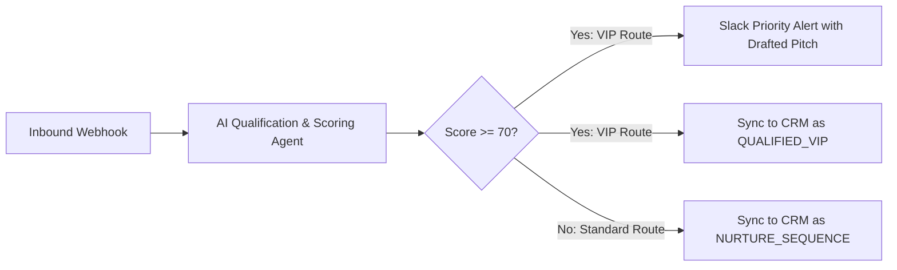

# Proof Asset 1: Enterprise Autonomous AI Lead Triage & CRM Sync

## Overview
This production-grade n8n workflow blueprint solves the highest-demand automation problem facing modern B2B sales teams: **instant, intelligent lead qualification, scoring, CRM synchronization, and executive escalation.**

Instead of paying $500–$2,000/mo in SaaS per-task execution fees (e.g. Zapier / Make), this workflow runs on self-hosted n8n infrastructure with zero volume penalties.

---

## Architecture & Flow

### Key Technical Capabilities
1. **Zero-Latency Inbound Webhook:** Connects seamlessly to Typeform, Webflow, Webhook sources, or Stripe checkout notifications.
2. **LangChain-Powered Structured Extraction:** Utilizes an LLM node with JSON schema enforcement to score urgency, budget, technical fit, and generate an instant personalized response draft.
3. **Smart Branching:** Dynamically routes high-ticket leads ($\ge 70$ score) directly to executive Slack channels while automatically organizing standard leads into automated email nurture tracks.
4. **Resilient CRM Sync:** Automatically maps contact records, status flags, and custom attributes to HubSpot or Pipedrive.

---

## How to Import & Run
1. Open your n8n instance (Self-hosted or Cloud).
2. Go to **Workflows $\rightarrow$ Import from File**.
3. Select `n8n_ai_lead_triage.json`.
4. Connect your OpenAI API key and HubSpot/Slack credentials.
5. Click **Activate**.
